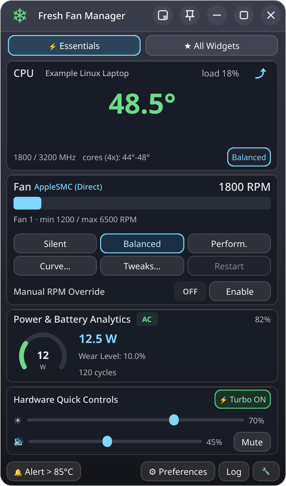
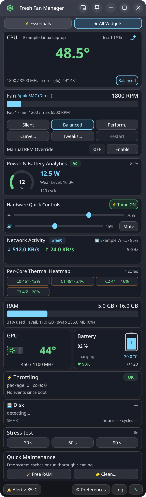
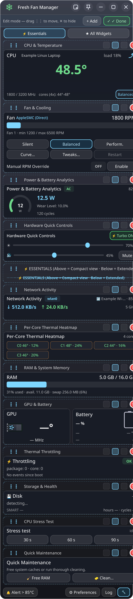
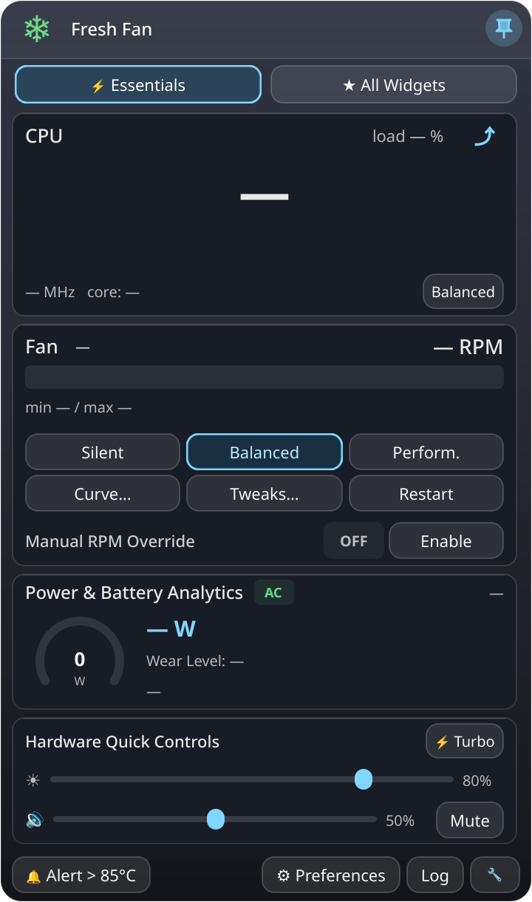
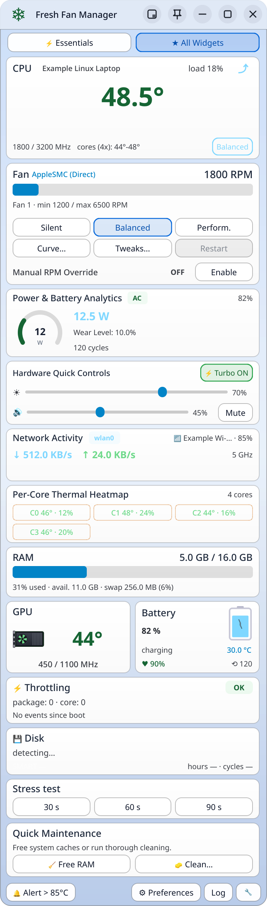
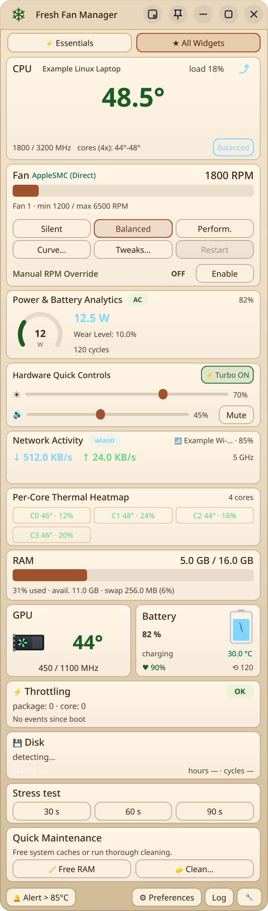
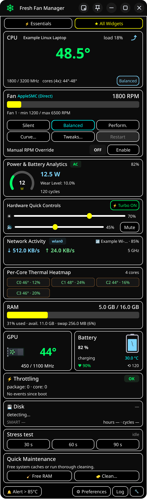
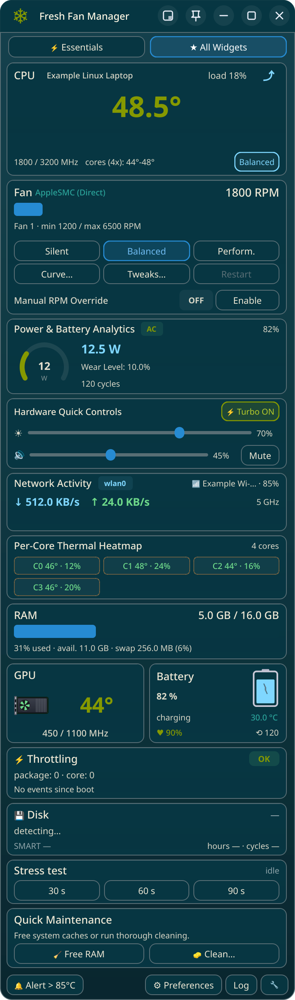
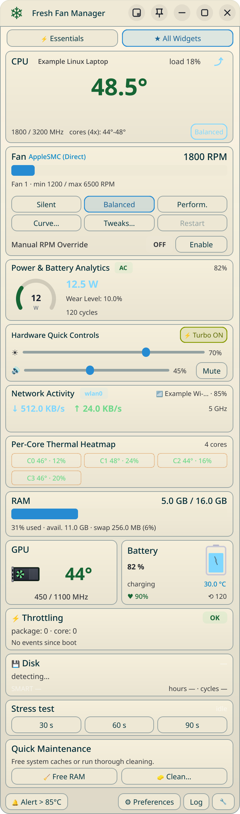

<p align="center">
  
</p>

<h1 align="center">Fresh Fan Manager</h1>

<p align="center">
  Hardware monitoring and adaptive fan controls for Linux.<br>
  A compact desktop dashboard with thermal protection, modular widgets and a headless watchdog.
</p>

<p align="center">
  <a href="#screenshots">Screenshots</a> ·
  <a href="#supported-systems">Supported systems</a> ·
  <a href="#supported-hardware">Supported hardware</a> ·
  <a href="#installation">Installation</a> ·
  <a href="#usage">Usage</a> ·
  <a href="LICENSE">GPL-3.0-or-later</a>
</p>

Fresh Fan Manager brings CPU temperatures, fan speeds, memory, GPU, power, network
and storage information into one configurable PySide6 dashboard. Use it as a
regular window, a tray monitor, a pinned desktop widget or a small floating display.
A separate headless mode provides background thermal monitoring.

Cooling controls adapt to the interfaces exposed by your Linux drivers. Supported
backends include ThinkPad ACPI, ASUS WMI, Dell thermal profiles, Apple SMC, generic
hwmon PWM and mbpfan. On systems without a supported control interface, hardware
monitoring remains available while cooling stays under firmware control.

**Current version:** 2.0.0 · **Platform:** Linux · **Python:** 3.9+ · **GUI:** PySide6 / Qt 6

## Screenshots

<p align="center">
  <a href="docs/screenshots/dark-essentials.png">
    
  </a>
</p>

<p align="center"><em>Essentials view: the main controls in a compact, 360-pixel-wide dashboard.</em></p>

The screenshots show the application's actual Qt widgets, rendered at 2× scale
with reproducible demo telemetry. Values and device names are illustrative.
Select an image to open the full-resolution version.

<details>
<summary><strong>Full dashboard, widget customization and desktop widget</strong></summary>

| All widgets | Customize your layout | Pinned widget preview |
| --- | --- | --- |
| [](docs/screenshots/dark-all.png) | [](docs/screenshots/dark-edit.png) | [](docs/screenshots/dark-widget.png) |

Move the Essentials divider to choose which cards appear in compact view.
Reorder cards, hide sections and adjust density from the layout editor.
Desktop pinning depends on the display server and compositor.

</details>

<details>
<summary><strong>Six built-in themes</strong></summary>

| Dark | Light | Sepia |
| --- | --- | --- |
| [](docs/screenshots/dark-all.png) | [](docs/screenshots/light-all.png) | [](docs/screenshots/sepia-all.png) |

| High contrast | Solarized dark | Solarized light |
| --- | --- | --- |
| [](docs/screenshots/hicontrast-all.png) | [](docs/screenshots/solarized_dark-all.png) | [](docs/screenshots/solarized_light-all.png) |

</details>

**Mini monitor**

[](docs/screenshots/mini.png)

## Features

### Hardware monitoring

- CPU temperature, package/core readings, load, frequency and governor.
- Per-core thermal heatmap, temperature history and throttling event counters.
- Fan RPM, detected limits and manual-control status.
- RAM usage, available memory, swap and zram-backed swap.
- GPU frequency and utilization when exposed by the driver or `nvidia-smi`.
- Battery charge, health, cycles and power information when available.
- Network upload/download rates and Wi-Fi connection details.
- Disk identification and available SMART health, temperature and lifetime metrics.
- Live top-processes dialog with CPU and memory sorting.

### Cooling and thermal protection

- Silent, Balanced and Performance presets adapted to the selected backend.
- Manual RPM override on compatible controllers; platform profiles on supported ASUS and Dell devices.
- Fan-curve and threshold configuration for mbpfan-based setups.
- Configurable high-temperature notifications and a manual-control watchdog.
- A bounded stress test with `stress-ng`, `stress` or a Python fallback.
- Stress cancellation that terminates the workload's child processes as well as its parent.

The manual-control watchdog defaults to **70°C**. When enabled, it attempts to
restore automatic fan control at the threshold or if CPU temperature becomes
unavailable. Stress tests stop at the lower of the configured safety threshold
and 90°C. Failed control commands are reported instead of being shown as successful.
These application-level checks require the process to remain running and do not
replace firmware or kernel thermal protection.

### Desktop controls and maintenance

- Brightness, audio volume/mute and CPU turbo controls where supported.
- Memory-cache flushing through an authenticated system helper.
- Package-cache cleanup for pacman, APT and DNF, plus systemd journal cleanup.
- User cache, thumbnail and trash cleanup under the desktop user's permissions.
- Optional manual, daily or weekly release checks, with changelog and download links.

### A configurable workspace

- Twelve cards with persistent order, visibility and density settings.
- Essentials and All Widgets views, separated by a movable divider.
- A fixed width of **360 logical pixels**, with vertical resizing and magnetic card stops.
- Six themes, transparency settings and optional background effects.
- Temperature-aware tray icon, floating mini monitor and desktop widget mode.
- Eleven selectable languages: English, Italian, Spanish, French, German,
  Portuguese, Russian, Chinese, Japanese, Arabic and Hindi.

English is the default. Some recently added labels use English fallback in other languages.

## Supported systems

Linux support is organized around the installed package manager and available
Python/Qt dependencies. The following installer routes are implemented:

| Distribution family | Examples | Installer integration | Package format |
| --- | --- | --- | --- |
| Arch Linux | Arch, CachyOS, Manjaro, EndeavourOS | pacman | `.pkg.tar.zst` |
| Debian / Ubuntu | Debian, Ubuntu, Linux Mint, Pop!_OS, Parrot OS | APT | `.deb` |
| Fedora / Red Hat | Fedora, RHEL and compatible systems with the required dependencies | DNF | `.rpm` |
| openSUSE | Tumbleweed, Leap where dependencies are available | Zypper | `.rpm` |
| Other Linux distributions | Systems providing Python, psutil and Qt 6 | Manual Python setup; system integration may need adaptation | Source / Python wheel |

Package names and dependency availability vary between distribution releases.
Debian amd64, Arch x86_64 and RPM x86_64 packages have been built locally;
this does not imply installation testing on every distribution listed above.

### Architectures

| Architecture | Build support | Native Apple SMC port library |
| --- | --- | --- |
| x86_64 / amd64 | Debian, Arch and RPM build paths; locally verified | Built for x86; used only on detected Intel Apple hardware |
| aarch64 / arm64 | Debian and Arch build paths are provided; not validated on an ARM machine | Not built or used |

Sensor availability and cooling controls depend on the target machine's drivers.
ARM build support is not a claim of certified Apple Silicon fan control.

### Desktop environments and display servers

| Environment | Behavior |
| --- | --- |
| X11 | Standard window, tray integration and xcb desktop-widget mode |
| XWayland | xcb interface inside a Wayland session; pinning depends on the compositor |
| Native Wayland | Normal Qt window and mini monitor when the Qt Wayland plugin is installed; absolute positioning is compositor-controlled |
| Headless Linux | `--daemon` runs without importing Qt or requiring a graphical display; hardware writes still need authorization |

KDE Plasma, GNOME, XFCE and other desktops can host the Qt interface when their
Qt/platform dependencies are available. A tray host or desktop extension may be
needed. GNOME, Hyprland, i3/Sway and other sessions have not all been independently
validated. Pinned desktop mode uses **xcb**, rather than native Wayland.

## Supported hardware

Fresh Fan Manager detects **driver interfaces**, rather than enabling controls
from a manufacturer name alone. The tables below describe implemented backends
and their requirements. They are not a device-certification list.

### Cooling controllers

| Hardware family | Required Linux interface | Available controls |
| --- | --- | --- |
| Lenovo ThinkPad | `/proc/acpi/ibm/fan`, with fan control enabled by the driver | Preset fan levels, manual levels and automatic mode |
| ASUS laptops, including compatible ROG/TUF models | `asus-nb-wmi/throttle_thermal_policy` or `fan_boost_mode` | Platform thermal/fan profiles |
| Dell laptops | `dell-laptop/thermal_profile` | Quiet, balanced and performance platform profiles |
| Intel Apple Mac | `applesmc` sysfs fan controls | Fan readings, manual RPM and automatic mode; optional mbpfan integration |
| Apple systems with a compatible `/dev/smc` driver | Driver-specific SMC ioctl interface | Fan readings and supported manual/automatic commands; optional x86 port fallback on Intel Apple hardware |
| Generic Linux laptops and desktop boards | hwmon `pwm[1-9]` and the corresponding enable interface | Fixed-duty presets, manual PWM and automatic mode where supported |
| Apple systems using mbpfan | Installed mbpfan service and a compatible SMC driver | Daemon presets and configuration/curve editing |
| Systems without a supported writable interface | Readable hardware sensors | Telemetry with firmware-managed cooling |

Framework, HP, Acer, Tuxedo, Clevo and other systems may work through the generic
PWM backend when their kernel driver exposes a compatible controller. The app
selects the first detected PWM channel; confirm that it corresponds to the fan you
intend to control. This is not automatic management of every motherboard fan header.

Dell control currently requires the specific profile interface listed above;
other Dell interfaces are not interchangeable. Apple T2 and Apple Silicon support
is driver-dependent and has not been physically validated. There is no assumed
kernel-version boundary at which `applesmc` universally becomes `macsmc`.

### Sensors and telemetry

| Component | Implemented data sources | Availability notes |
| --- | --- | --- |
| Intel CPU | `coretemp`, compatible hwmon labels and psutil | Temperature, load and frequency depend on exposed sensors |
| AMD CPU | `k10temp`, `zenpower` and compatible hwmon labels | Package/core detail varies by processor and driver |
| ARM / SoC / ACPI temperatures | Recognized hwmon devices such as `cpu_thermal`, `soc_thermal` and `acpitz` | Requires an exposed, readable hwmon temperature interface |
| Intel GPU | Intel DRM device discovery, `gt_*` frequency files and engine busy counters | Primarily the implemented i915-style interfaces; other driver layouts may provide only partial data |
| AMD Radeon GPU | amdgpu utilization and hwmon frequency files | Driver-dependent frequency and utilization readings |
| NVIDIA GPU | `nvidia-smi` | Requires the utility and a supported driver; available fields vary |
| Battery and power | Linux power-supply interfaces and available platform readings | Battery-less systems are supported; health/cycle fields may be absent |
| Memory and swap | psutil / Linux memory statistics | Includes active disk swap and zram-backed swap |
| Storage | Root-device detection, sysfs and available SMART tools; Apple SMC temperature fallback | SMART access may require additional permissions; Btrfs subvolume source names are handled |
| Network | Interface counters and available Wi-Fi tools/interfaces | Throughput works independently of optional SSID, band and signal details |

The local read-only validation detected **macsmc, CPU temperature, one fan, RAM,
GPU telemetry and network data**. The test session had no battery and no usable
disk reading; both cases were handled. Physical write tests across all vendors
remain outside that validation. See the [validation report](docs/VALIDATION.md).

## Installation

### Install from source with system integration

```bash
git clone https://github.com/tonythewizard/fresh-fan-manager.git
cd fresh-fan-manager
./install.sh
```

The installer selects the distribution integration, prepares a Python environment,
installs the launcher and desktop entries, and configures the Polkit helper and
user systemd service. On x86, it also builds the native SMC library from source.
Administrative operations request authentication when needed.

You can also download and review the installer before executing it:

```bash
curl -fLO https://raw.githubusercontent.com/tonythewizard/fresh-fan-manager/main/install.sh
bash install.sh
```

### Install a native package

Download a matching package from [GitHub Releases](https://github.com/tonythewizard/fresh-fan-manager/releases)
when a release is published, or build one locally. Example installation commands
for the current amd64/x86_64 artifacts:

```bash
# Debian / Ubuntu family
sudo apt install ./dist/fresh-fan-manager_2.0.0_amd64.deb

# Arch Linux family
sudo pacman -U ./dist/fresh-fan-manager-2.0.0-1-x86_64.pkg.tar.zst

# Fedora
sudo dnf install ./dist/fresh-fan-manager-2.0.0-1.x86_64.rpm

# openSUSE
sudo zypper install ./dist/fresh-fan-manager-2.0.0-1.x86_64.rpm
```

A local build does not publish a GitHub release. Choose a package matching the
machine's architecture and use the distribution's package manager to resolve dependencies.

### Run from a development checkout

For an isolated GUI/monitoring environment:

```bash
python3 -m venv --system-site-packages .venv
.venv/bin/python -m pip install -r requirements.txt
.venv/bin/python fresh_fan_manager.py
```

This starts the interface from the checkout. Privileged controls use the installed
system helper, so testing a new frontend does not update an older helper automatically.
Use the full installer or native package to deploy those components together.

### Python-only installation

```bash
pipx install 'fresh-fan-manager[gui] @ git+https://github.com/tonythewizard/fresh-fan-manager.git'
```

The Python package provides the application code. It does not install system-wide
Polkit policies, the privileged helper, udev rules, the native library or the systemd
unit. The source installer and native packages provide that integration.

### Requirements and optional tools

| Dependency | Purpose |
| --- | --- |
| Python 3.9+ and psutil 5.9+ | Core application and telemetry |
| PySide6 6.5–6.x | Graphical interface; unnecessary for `--daemon` |
| Polkit and an authentication agent | Authorized system controls in desktop sessions |
| GCC | Building the optional native Intel SMC library |
| `smartctl` / smartmontools | Additional disk SMART information |
| `stress-ng` or `stress` | External stress-test engines; a Python fallback is available |
| mbpfan | Optional Apple fan-management backend |
| `wpctl` or `pactl` | Audio volume and mute integration |

Some platform controls also require the corresponding kernel module and writable
interface. The native SMC library is restricted to its trusted, root-owned installation.

## Usage

```bash
fresh-fan-manager             # Open the main dashboard
fresh-fan-manager --mini      # Start the floating mini monitor
fresh-fan-manager --settings  # Open preferences at startup
fresh-fan-manager --tray      # Start hidden in the system tray
fresh-fan-manager --widget    # Start in pinned desktop mode (xcb)
fresh-fan-manager --daemon    # Start the headless watchdog
fresh-fan-manager --version   # Print the application version
fresh-fan-manager --help      # Show command-line options
```

Open **Preferences** to select language, theme, display server, alert thresholds
and release-check frequency. Use the layout editor to organize the cards and move
the Essentials divider. Mini mode provides temperature and fan speed in a small
floating window; the tray indicator keeps those readings accessible when the main
window is hidden.

### Headless mode

For installations that include the user service:

```bash
systemctl --user enable --now fresh-fan-daemon.service
systemctl --user status fresh-fan-daemon.service
journalctl --user -u fresh-fan-daemon.service
```

The daemon monitors manual fans, applies its watchdog and restores controls it owns
on shutdown. An explicitly selected preset can drive the direct AppleSMC fan curve;
other backends keep their own preset behavior. The GUI and daemon share a per-user
controller lease, so stop the service before opening the GUI for the same account:

```bash
systemctl --user stop fresh-fan-daemon.service
```

Hardware writes still require authorization. A headless session without a Polkit
agent may reject them; the failure is logged. Independent users and external fan
daemons must be configured to avoid competing control of the same hardware.

### Release updates

**Preferences → Updates** offers manual, daily and weekly checks. Automatic checks
are disabled by default. The checker contacts the public GitHub Releases API,
sends no hardware telemetry and handles offline, timeout and rate-limit responses.

When a newer stable release is available, an arrow in the title bar opens its
Markdown changelog and package download links. Package installation remains an
explicit action through your package manager.

For a Git checkout, the update action opens a terminal running
`tools/update_checkout.sh`. The script requires a clean checkout, the expected
origin and the `main` branch. It performs a fast-forward pull and runs `make update`
to reinstall, preserving local work by refusing a dirty checkout. Restart the app
after an update. The updater does not create commits, reset local changes or push.

## Build and development

```bash
make test                   # Python, Qt, shell and native C checks
make layouts                # Exhaustive card visibility/geometry validation
make screenshots            # Regenerate the screenshot gallery from demo data
make deb                    # Build a Debian package
make arch                   # Build an Arch package with makepkg
make rpm                    # Build an RPM with rpmbuild
make all-pkgs               # Build all native package formats
.venv/bin/python -m build    # Build a Python wheel and source distribution
```

Native artifacts are written to `dist/`. Each target requires its build toolchain;
ARM builds require a suitable ARM build environment. Python distributions require
the `build` package in the selected environment. `make test` uses the checkout's
`.venv` when present, or the system interpreter; set `PYTHON=...` to choose another.

The current validation includes **39 regression tests**, Qt rendering at 100%,
125% and 150% scale, and all **4,096 visibility combinations** of the twelve cards.
Geometry is checked against five logical screen heights, from 768 to 2160 pixels.
These are automated checks, alongside a local read-only hardware sample; they do
not certify every laptop, distribution or compositor.

### Project structure

```text
fresh-fan-manager/
├── fresh_fan_manager.py     Application entry point and CLI
├── core/                   Sensors, control backends, watchdog, settings and updates
├── ui/                     Dashboard, cards, dialogs, tray and mini monitor
├── bin/                    Privileged helper and compatibility alias
├── native/                 Intel Apple SMC port library source
├── policies/               Polkit authentication policy
├── autostart/              Desktop entries and user systemd service
├── tests/                  Automated regression suite
├── tools/                  Packaging, update and screenshot utilities
└── docs/                   Screenshots, validation and repository metadata
```

## Troubleshooting and reporting issues

| Symptom | What to check |
| --- | --- |
| Monitoring works, fan control is unavailable | The detected backend in Preferences, kernel driver and exported control interface |
| A privileged action fails | Installed helper version, Polkit service and desktop authentication agent |
| The GUI reports another controller is running | Stop the user daemon or close the other GUI instance |
| A sensor displays unavailable data | Driver support, device presence and permissions; missing metrics are not always an application error |
| Pinned mode or positioning behaves differently on Wayland | Use xcb/XWayland for pinned mode and check compositor behavior |
| SMART data is missing | smartmontools availability, disk visibility and SMART permissions |

Report reproducible problems through [GitHub Issues](https://github.com/tonythewizard/fresh-fan-manager/issues).
Include the application version, distribution, kernel, desktop/display server,
hardware model, detected backend and steps to reproduce. Logs are available from
the application's **Log** button and at:

```text
~/.local/share/fresh-fan-manager/fresh-fan-manager.log
```

Development details are in the [roadmap](roadmap.md), [handoff](HANDOFF.md) and
[validation report](docs/VALIDATION.md). Repository description and topics are
prepared in [GitHub metadata](docs/GITHUB_ABOUT.md).

## Uninstallation

For a script installation:

```bash
./uninstall.sh
```

The uninstaller removes system integration, both helper names, the native library,
udev rules and the service. It offers to retain or remove user settings and logs.
For package-managed installations, uninstall through the same package manager.

## License

Fresh Fan Manager is licensed under **GPL-3.0-or-later**. See [LICENSE](LICENSE)
and [third-party notices](THIRD_PARTY_NOTICES.md) for dependency information and
attribution. Existing copyright notices are preserved.
